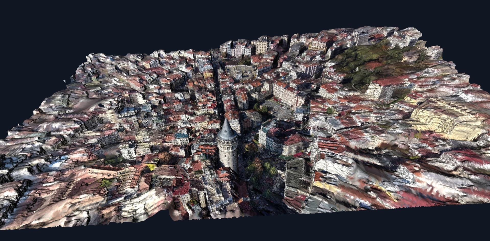
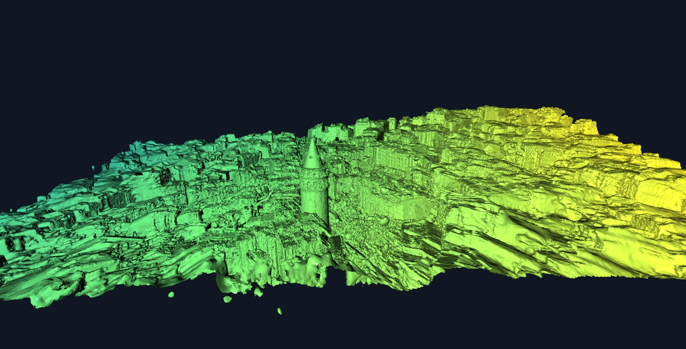
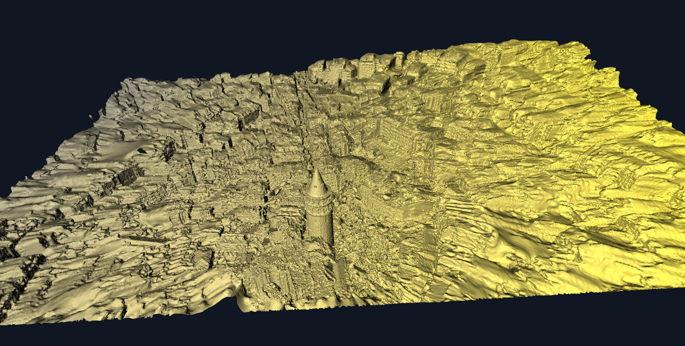

<div align="center">

# Scene Reconstruction Tools

**A practical desktop toolkit for preparing COLMAP image sets and exploring 3D reconstructions.**

[](https://www.python.org/)
[](http://www.open3d.org/)
[](https://www.microsoft.com/windows)

**From video frames to a navigable 3D result — in one small collection of tools.**

</div>

<p align="center">
  
</p>

<p align="center"><em>Example result: a textured city reconstruction inspected in PLY Studio.</em></p>

<p align="center">
  <a href="#tools-at-a-glance">Explore the tools</a> ·
  <a href="#quick-start">Quick start</a> ·
  <a href="#screenshots">More screenshots</a> ·
  <a href="#project-layout">Project layout</a>
</p>

---

## What is this?

Scene Reconstruction Tools brings together the small utilities used before and after a photogrammetry workflow. Extract usable images from a video, arrange four reference photographs in a 3D scene, and inspect point-cloud or mesh output without leaving the desktop.

The project is organized as focused Python modules, with command-line launchers for each tool. It uses **OpenCV** for video and image processing and **Open3D** for interactive 3D visualization.

## Tools at a glance

| Tool | What it does |
| --- | --- |
| **COLMAP Frame Extractor** | Samples video at a target rate, optionally filters blurry frames, resizes large images, and records frame metadata in a CSV manifest. |
| **Four-Camera Viewer** | Builds an interactive Open3D scene from four directional photographs, with textured planes, camera models, and viewing frustums. |
| **PLY Studio** | Opens PLY point clouds and triangle meshes for interactive inspection, coloring, styling, orbiting, and image/video capture. |
| **Window Recorder** | Captures the PLY Studio window and writes AVI frames in a background thread. Window recording currently targets Windows. |

## Quick start

### 1. Requirements

- Python **3.10 or newer**
- Windows for the PLY Studio window-recording feature
- A desktop session and working graphics drivers for the Open3D viewers

### 2. Install

In PowerShell, clone the repository and create an isolated environment:

```powershell
git clone <your-repository-url>
cd <your-repository-folder>

py -m venv .venv
.\.venv\Scripts\Activate.ps1
python -m pip install --upgrade pip
python -m pip install -e .
```

Alternatively, install dependencies from the requirements file:

```powershell
python -m pip install -r requirements.txt
```

### 3. Launch a tool

After installation, these commands are available:

```powershell
extract-colmap-frames --help
four-camera-viewer --help
ply-studio --help
```

You can also run the modules directly from the repository with `python -m`, or use the original top-level scripts as compatibility launchers.

## Workflows

### Extract video frames for COLMAP

Choose a video and an **empty** output directory. The extractor intentionally prevents mixing new frames with images from an earlier run.

```powershell
extract-colmap-frames `
  --video "D:\Videos\city-walk.mp4" `
  --output "D:\COLMAP\city-walk\images" `
  --fps 2 `
  --max-side 1600
```

The output contains sequentially named JPEG frames and a `frames_manifest.csv` containing source frame numbers, timestamps, image dimensions, and sharpness scores when blur filtering is enabled.

| Option | Default | Description |
| --- | ---: | --- |
| `--fps` | `2.0` | Approximate number of sampled frames per second |
| `--max-side` | `1600` | Maximum image dimension; smaller images are not enlarged |
| `--jpg-quality` | `95` | JPEG quality from 1 to 100 |
| `--min-sharpness` | `0` | Optional Laplacian-variance blur threshold; `0` disables the filter |

Sharpness values depend on the source footage and its resolution, so choose a threshold based on a representative test rather than assuming one value works for every video.

### Arrange four camera photographs

Create a folder containing one image in each numbered camera directory:

```text
camera_images/
├── 1/
│   └── front.jpg
├── 2/
│   └── right.jpg
├── 3/
│   └── back.jpg
└── 4/
    └── left.jpg
```

Launch the viewer and optionally adjust the layout:

```powershell
four-camera-viewer .\camera_images
four-camera-viewer .\camera_images --radius 3.5 --image-width 1.5
```

Every numbered directory must contain **exactly one** supported image. Drag in the 3D window to orbit and zoom. Use the terminal that launched the viewer to control the automatic orbit:

```text
help
axis x
speed 12
direction cw
orbit start
orbit stop
```

### Inspect a PLY point cloud or mesh

Open a reconstruction:

```powershell
ply-studio "D:\models\city-reconstruction.ply"
```

Choose a mesh view, height coloring, a color palette, and a reference grid at startup:

```powershell
ply-studio "D:\models\city-reconstruction.ply" `
  --view mesh `
  --color height `
  --palette cividis `
  --grid
```

Once the viewer is open, type `help` in its terminal for the full interactive command list. PLY Studio supports:

- Switching between point-cloud and mesh views
- Solid colors, stored/original colors, and height-based coloring
- Color palettes including `spectrum`, `ocean`, `sunset`, `cividis`, `plasma`, `inferno`, and `magma`
- Presentation styles, background colors, grid, axes, and wireframe layers
- Mouse orbit and pan, scroll-wheel zoom, and automatic camera rotation around a picked or specified center
- Saving a view as a PNG image
- Recording the visible PLY Studio window to an AVI file

AVI recordings are saved in `recordings/`. Keep the window restored and do not resize it while recording.

## Screenshots

The hero image at the top shows the textured mesh. These two examples demonstrate alternative inspection styles:

<table>
  <tr>
    <td align="center">
      
      <br><strong>Elevation coloring</strong><br>
      <sub>Color transitions help distinguish lower and higher parts of the scene.</sub>
    </td>
    <td align="center">
      
      <br><strong>Monochrome style</strong><br>
      <sub>A neutral treatment puts the focus on geometry and surface detail.</sub>
    </td>
  </tr>
</table>

## Run from the repository

The same applications can be launched as Python modules:

```powershell
python -m scene_tools.colmap_frames --video "D:\Videos\city-walk.mp4" --output "D:\COLMAP\city-walk\images"
python -m scene_tools.camera_viewer .\camera_images
python -m scene_tools.ply_viewer "D:\models\city-reconstruction.ply"
```

The original script filenames remain available:

```powershell
python .\extract_colmap_frames.py --help
python .\four_camera_viewer.py --help
python .\ply_viewer.py --help
```

## Project layout

```text
scene_tools/
├── colmap_frames.py              # Frame-extraction CLI and workflow
├── camera_viewer/
│   ├── app.py                    # Viewer window, input, and orbit controls
│   └── scene.py                  # Camera image data and 3D geometry
├── ply_viewer/
│   ├── app.py                    # PLY Studio state and model loading
│   ├── appearance.py             # Colors, palettes, and visual styles
│   ├── geometry.py               # PLY inspection, grid, and point picking
│   ├── interactions.py           # Mouse controls, zoom, and orbit behavior
│   ├── commands.py               # Interactive terminal commands
│   └── runtime.py                # Viewer lifecycle and recording integration
└── recording/
    └── screen_recorder.py        # Windows capture and asynchronous AVI writer

docs/
└── images/                       # README demonstration screenshots
```

## Development

Run the test suite and compile-check the package:

```powershell
python -m unittest discover -s tests -v
python -m compileall -q scene_tools
```

## License

No license has been selected for this project yet. Add a `LICENSE` file before publishing if you want to grant others permission to use, modify, or redistribute the code.
